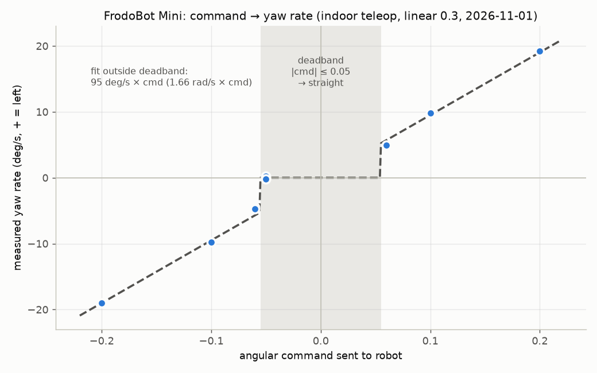
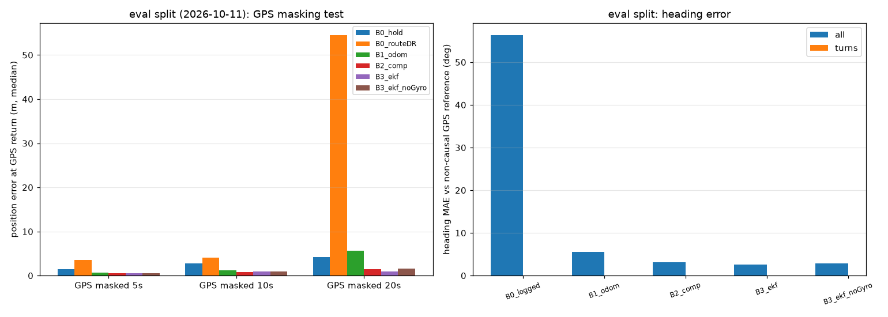

# FrodoBot Mini 배포 진행 보고 (2026-11-01)

OmniVLA-Edge(rides_11 파인튜닝) 모델을 FrodoBot Mini에 배포하면서 **"모델이 예측한 경로를 로봇이
따라가지 못한다"**는 문제가 반복됐다. 이번 작업은 원인을 모델 / 제어 / 입력(지도 heading) 세 층으로
나눠, 모델을 재학습하기 전에 로봇 쪽에서 원인을 하나씩 실측으로 확인하는 데 집중했다.

---

## 1. 핵심 결과 요약

| # | 결과 | 근거 |
|---|---|---|
| 1 | **로봇은 angular 명령 \|cmd\| ≤ 0.05를 무시하고 직진**하며, 0.06부터는 명령에 비례해(약 1.66 rad/s × cmd) 갑자기 회전한다 | 실내 teleop 10회, 자이로·rpm 실측 |
| 2 | 그래서 **모델의 작은 조향은 전부 사라지고, 큰 조향은 의도보다 약 1.4배 과하게** 꺾였다. 기존 트림 -0.051은 사실 "10% 틱만 -0.06"을 보내던 것 | 위 실측 + 기존 실주행 로그 6,000여 틱 |
| 3 | 실측 기반 **명령 변환 보정**을 구현했다 (단위 변환 + deadband 구간은 0과 ±0.06을 시간 비율로 섞음) | 오프라인 테스트 통과, 실외 검증 예정 |
| 4 | 배포에 쓰던 heading이 실제 진행방향과 **중앙값 44° 어긋나** 있었다 → 모델에 들어가는 지도가 heading-up이 아니었음 | 기존 로그 리플레이 |
| 5 | 자이로 + rpm + GPS 융합으로 heading 오차가 직선 구간 **2.6~3.2°**, GPS 동결 중 위치 오차가 **약 1/3**로 줄었다 | 오프라인 리플레이 (실주행 70 run) |
| 6 | dead reckoning이 로봇 `speed` 필드를 m/s로 착각해 **거리를 약 3배 과대 추정**하던 버그를 찾아 수정했다 | 28 run 비교 3.75배 → 1.21배, 실내 줄자 실측과 3.5% 일치 |

---

## 2. 명령 → 로봇 동작 실측 (실내 teleop, 모델 미사용)

모델을 빼고 고정 angular 명령만 보내서, 자이로(회전 속도)와 바퀴 rpm(이동 거리)을 기록했다.

| 명령 | 회전 속도 (deg/s) | 좌우 바퀴 rpm 차이 | 회전 반경 |
|---|---|---|---|
| -0.05 ~ +0.05 | 약 0 | 0% | 직진 |
| ±0.06 | ±4.5 ~ 5.4 | 8~11% | 약 4~5m |
| ±0.10 | ±10 | 14% | 약 2m |
| ±0.20 | ±19 | 30% | 약 1.1m |

- **반응 없음 구간(deadband):** \|cmd\| ≤ 0.05에서는 좌우 바퀴가 똑같이 돈다. 기존 실외 로그
  6,000여 틱에서도 같은 구조가 확인됐다.
- **좌우 대칭:** 같은 크기의 좌/우 명령에서 회전 속도 차이가 5~10% 이내다. 10/11에 본
  "우회전이 약하다"는 하드웨어가 아니라 모델·트림 설정 쪽 문제였다.
- **단위 불일치:** 배포 코드는 모델이 계산한 회전 속도(rad/s)를 그대로 명령으로 보냈는데, 실제로는
  그 1.66배로 돈다. linear도 0.3을 보내면 실제 약 0.36 m/s(1.2배).
- **트림이 위험했던 이유:** 트림 -0.051 + 디더링은 "-0.05(직진)"와 "-0.06(반경 5m 우회전)"을 섞는
  것이었다. 트림을 -0.0537로 0.0027만 바꿔도 -0.06 비율이 10% → 37%로 늘어 벽에 충돌했다(재현됨).

### 모델 출력 추종이 안 됐던 이유 (한 줄)

모델의 작은 조향(±0.05 이내)은 로봇이 아예 무시했고, 큰 조향은 의도보다 약 1.4배 과하게
꺾었으며, 여기에 트림 -0.051이 붙어 아주 작은 우회전 출력도 반경 약 5m 급우회전으로 튀었다.

### 구현: 명령 변환 보정 (`--enable_actuation_calibration`, 기본 꺼짐)

1. 모델이 원한 rad/s ÷ 1.66, m/s ÷ 1.2로 로봇 명령 단위로 변환
2. 변환값이 0.06보다 작으면 0과 ±0.06을 시간 비율로 섞어 보냄(델타-시그마). 반응이 비례 구조라
   평균 회전 속도가 원하는 값과 같아진다 (예: 0.03이 필요하면 틱의 절반만 0.06)
3. 트림·디더링·우회전 게인 같은 기존 증상 보정을 대체

오프라인 검증: 원하는 회전 속도 7가지에서 실현 평균 오차 0.0004 rad/s 이하, deadband 안 값은 한 번도
전송되지 않음. **실외 게인은 아직 미검증** (기존 실외 로그에서는 -0.06 반응이 실내보다 약했음).

---

## 3. 지도 heading 문제 (모델 입력)

모델은 **로봇 진행방향이 위로 오는(heading-up) OSM 지도**로 학습됐다. 학습 데이터 heading은
"현재 GPS 점 → 다음 GPS 점" 방향이다. 배포 때도 같은 조건이어야 하는데, 지금까지 쓴 heading 소스는
모두 한계가 있었다.

| heading 소스 | 문제 |
|---|---|
| GPS 궤적 | 1.5m 이상 움직여야 값이 나오고 회전 후 늦게 따라옴. 0.42m 양자화·잦은 동결(주행 틱의 75%)로 틱마다 수십 도 흔들림 |
| 경로 방향 고정 (route_bearing_anchor) | 측정이 아니라 "경로를 보고 있다"는 가정. 실제 진행방향과 **중앙값 44°** 차이 |
| 나침반 | 자기장 간섭으로 세션마다 +11° ~ +169° 오차 |

### 해결 방향: 자이로로 회전을 따라가고 GPS로 바로잡기

- 출발 시 정렬한 방향을 초기 heading으로 쓰고, 정지 중 자이로 오프셋을 측정해 뺀다
- 주행 중 자이로로 회전을 매 틱 반영 → 회전하는 동안에도 지도가 heading-up을 유지
- 자이로 샘플이 빈 틱은 좌우 rpm 차이로 메꾸고, 1.5m 이상 이동 시 GPS 진행방향으로 조금씩 보정

실내 run 비교에서 자이로 적분은 직진 시 ±2° 이내였고, rpm 적분은 직진에서도 8~12°가 쌓였다(정수
rpm 양자화). 회전 구간에서는 둘 다 5~15% 이내로 맞았다 → **자이로 주, rpm 보조**.

---

## 4. 위치 추정 필터 (원거리 주행용, 오프라인 검증)

기존 실주행 로그 70 run(10/04 이전으로 튜닝, 10/11로 평가)을 리플레이했다. GPS를 일부러 T초 가린 뒤
다시 들어온 GPS와의 위치 오차(중앙값):

| 방법 | 5초 | 10초 |
|---|---|---|
| GPS 마지막 값 유지 (현재 배포 기본) | 1.43m | 2.72m |
| complementary 필터 (rpm + 자이로 + GPS) | **0.49m** | **0.83m** |
| EKF | 0.59m | 0.88m |

- 센서 감사에서 확인한 사실: 자이로·rpm은 시간의 약 17%만 샘플링되고, 명령 후 로봇 반응까지
  1~1.7초 지연이 있으며, 출발 직후 GPS가 50~84m 튀는 run이 있었다.
- **한계:** 회전 구간은 표본이 부족해 아직 평가하지 못했다. 필터는 아직 배포 코드에 들어가지 않았다.

---

## 5. 실험 설계 원칙

기존처럼 "모델을 그대로 돌려보기"만 하면 실패 원인을 분리할 수 없어서, 세 단계로 나눴다.

| 단계 | 질문 | 방법 | 상태 |
|---|---|---|---|
| A | 명령을 주면 로봇이 그대로 움직이나? | 모델 없이 고정 명령, 자이로·rpm·줄자 | **실내 완료** |
| B | 입력이 맞을 때 모델 예측이 맞나? | `--observe_only`(제어 안 보냄) + 사람이 조종, 예측 vs 실제 경로 | 모드 구현 완료 |
| C | 합쳐서 예측 경로대로 가나? | 직진+회전 경로, 보정 끔/켬 비교 | 실외 예정 |

---

## 6. 다음 계획

1. **실외 테스트 C:** 직진 10~15m → 60~90° 회전 경로를 보정 끔/켬으로 각 1회.
   모델이 원한 회전 vs 자이로 실측 회전을 직진/회전 구간별로 비교하고 실외 게인을 확인
   (분석 스크립트 `deployment/analysis/tracking_analysis.py` 준비됨)
2. **heading-up 지도:** 테스트 C 로그로 자이로 기반 heading을 오프라인 검증한 뒤 배포 코드에
   새 heading 모드로 반영
3. **원거리:** 위치 필터를 배포에 로그 전용(shadow)으로 넣고, 경로 생성 전 GPS 안정성 확인 가드 추가
4. **재학습 (장기):** 모델 자체의 작은 좌편향, 회전 구간 데이터 불균형

---

## 부록: 관련 파일과 커밋 (브랜치 `experiment-dead-reckoning`)

| 내용 | 위치 |
|---|---|
| 센서 감사 + 필터 비교 리플레이 | `deployment/analysis/imu_gps_fusion_replay.py`, 결과 `deployment/analysis/results/fusion_replay_20261101/` |
| 명령 → 회전 실측 데이터 | `deployment/logs/1101/teleop_test_*.jsonl`(로컬), 요약 `deployment/analysis/results/actuation_20261101/` |
| 실내 측정 절차 | `docs/1101_test_A_actuation.md` |
| DR 속도 단위 수정 | `8b456d6` |
| 관측 전용 모드, 필터 비교 | `b8e4a32` |
| 명령 변환 보정, teleop 자이로·rpm 기록 | `0859f07` |
